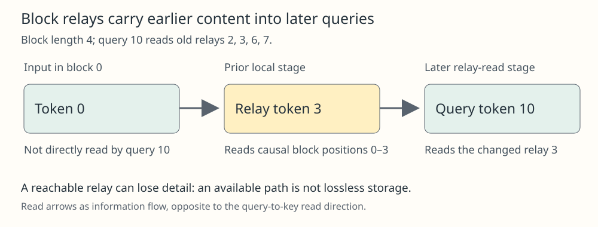

# Block-Summary Sparse Attention

## Meaning

Partition the sequence into blocks and reserve several positions in each block as globally readable relays. Local computation can place information from the block into those positions; later tokens read the relays instead of every old token. A “summary” here is a learned hidden representation, not an externally written natural-language digest or a promise that all evidence survives.

## Mechanism

For causal decoding, each token reads permitted earlier positions in its own block. A second pattern reads designated trailing positions of completed earlier blocks, with future tokens always masked. Multiple stages allow a relay to first gather block content and then transmit it onward. This is a specific [[sparse-attention-patterns]] design, not an assertion that every local/global model uses block-end relays.

The Sparse Transformer fixed pattern allows several trailing positions per block. Using only one position can constrain representation capacity; multiple heads can use different trailing subsets. Distinguish this from a single special global token with bidirectional access, and from a claim that a relay preserves every original token. The relay is a communication bottleneck, and both the number of relay positions and the number of attention stages affect what can be conveyed.

## One example

Use blocks 0–3, 4–7 and 8–11, with two trailing relays per completed block. Query 10 reads its causal local positions 8,9,10 and old relays 2,3,6,7. Position 0 is not directly readable by 10. A previous local stage lets relay 3 gather from positions 0–3; the later stage at 10 can then read that changed relay. If a task needs the exact distinction between several incompatible details from the first block, the existence of the path does not guarantee that two relay states encode those details adequately.

## Check your understanding

Does dividing the sequence into blocks automatically make attention linear-time? No. If every query reads relays from all past blocks, the count grows with the number of blocks. For N tokens, block size L and c relays per block, a simple bound is proportional to N(L+cN/L), before feature width and implementation costs. Fixed L and c still leave a quadratic term in N. Measure quality, relay capacity and realized sparse-kernel cost rather than labeling every block pattern “linear.”

## Prerequisites

- [[sparse-attention-patterns]]

## Sources

- <https://arxiv.org/html/1904.10509v1>
