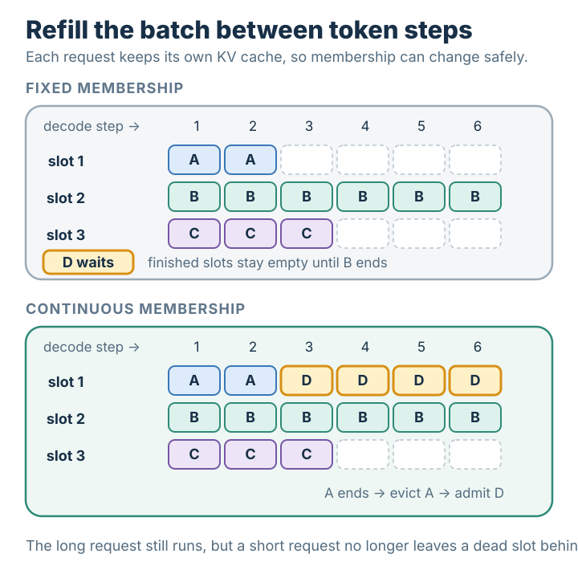

# 연속 배칭(Continuous Batching)

## 요약

연속 배칭은 최초 요청들이 모두 끝날 때까지 배치 구성을 고정하지 않고 모델 반복 사이에서 실행할 요청을 바꾼다. 각 요청의 독립 상태를 유지하면서 새로 생긴 여유를 대기 요청의 진행에 사용한다.

## 상세 설명

### 작동 원리와 불변식

일반적인 한 토큰 자기회귀 디코딩에서는 활성 요청마다 반복 한 번에 한 토큰씩 진행한다. [[kv-cache]]는 요청별 접두부 상태를 저장하므로 길이가 다른 요청도 서로의 상태를 읽지 않고 같은 배치에서 실행할 수 있다. 스케줄러는 반복 경계에서 완료·취소 요청을 제거하고 [[queue]]의 대기 작업 중 적격 요청을 넣는다. 불변식은 요청 상태의 독립적 정확성이지, 모든 슬롯이 항상 차 있다는 보장이 아니다. 프롬프트 처리, 토큰 예산, 캐시 용량, 우선순위와 서비스 제약이 입장을 막을 수 있다. 추측 디코딩이나 다중 토큰 디코딩도 반복당 여러 토큰을 진행하면서 같은 구성 변경 원리를 사용할 수 있다.

구성 고정 기준선에서는 완료된 요청의 자리를 그룹 전체가 끝날 때까지 새 요청에 쓸 수 없다. 구현이 죽은 행의 계산을 생략할 수도 있으므로 매번 전체 연산 비용이 같다고 단정하면 안 된다. 핵심은 진행 중인 작업에 새 요청을 넣을 수 있는가이다. 활성 요청 사이에서 가중치 읽기를 공유하면 처리량이 좋아질 수 있지만, 반복 시간은 배치 크기, 문맥 길이, 커널, 메모리 트래픽과 프리필 간섭에 따라 달라진다. 단일 요청 실행 시간과 자동으로 같아지지는 않는다.

### 가정을 명시한 예제

같은 시간이 걸리는 디코딩 단계와 요청 슬롯 두 개를 가정한다. 시작할 때 A는 두 단계, B는 다섯 단계가 필요하며 C는 세 단계를 기다린다. 구성 변경만 비교하도록 프롬프트 상태는 준비되어 있고 캐시가 충분하며 입장 오버헤드는 생략한다.

| 단계 | 구성 고정의 활성 작업 | 연속 배칭의 활성 작업 |
|---|---|---|
| 1 | A, B | A, B |
| 2 | A 완료, B | A 완료, B |
| 3 | B | C, B |
| 4 | B | C, B |
| 5 | B 완료 | C 완료, B 완료 |
| 6 | C | — |
| 7 | C | — |
| 8 | C 완료 | — |

두 방식 모두 유용한 토큰 단계는 2+5+3=10이다. 구성 고정은 2×8=16 슬롯·단계를 제공하므로 유용 점유율은 62.5%이고, 연속 배칭은 2×5=10이므로 이 단순 예제에서는 100%이다. A가 자리를 내놓은 직후 C를 시작해 종료 시점이 8단계에서 5단계로 당겨진다. 이 숫자는 GPU 실측 활용률이나 보편적인 속도 향상이 아니다. 실제 새 요청은 프리필이 필요할 수 있으며, 그 작업은 진행 중인 디코딩 단계도 늘릴 수 있다.

### 적용 경계와 검증

요청들이 동시에 끝난다면 완료 슬롯의 낭비를 줄일 여지가 작을 수 있다. 길이 변동, 도착 시점, 프롬프트 작업, 메모리 제약과 기준선이 효과를 결정하며 분산 하나로 처리량 배수를 정할 수는 없다. 배치가 커지면 연산량, 캐시 용량이나 꼬리 지연이 새 한계가 된다.

동일 모델, 체크포인트, 정밀도, 샘플링, 트래픽과 하드웨어에서 정책을 비교한다. 첫 토큰 지연, 토큰 사이 지연, 전체 꼬리 지연, 처리량, 공정성, 캐시 점유, 선점과 품질을 보고한다. 균일·혼합 출력 길이, 프롬프트 폭주, 취소와 메모리 압박도 포함한다. 연속 입장은 실행할 요청을 고르는 문제이고 페이지 캐시는 상태를 배치하는 문제다. Orca는 반복 단위 스케줄링을, PagedAttention 논문은 상보적인 캐시 할당을 설명한다.

## 선수 지식

- [[kv-cache]]
- [[queue]]

## 출처

- <https://www.usenix.org/conference/osdi22/presentation/yu>
- <https://arxiv.org/abs/2309.06180>
