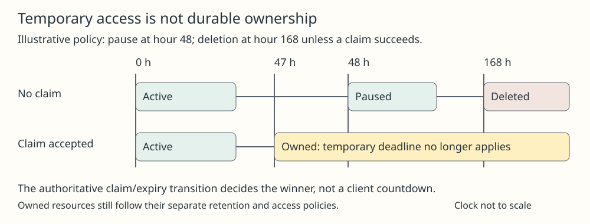

# Expiring Resource Ownership

## Meaning

A temporary resource can be usable before it has a lasting owner. Its lifecycle must distinguish permission to use it, permission to claim it and the deadline after which use or recovery ends. A resource that is paused is not necessarily deleted; one that is claimed is not necessarily free of all later retention rules.

## Mechanism

Model the authoritative states and allowed transitions. One possible policy is `provisioning → active → paused → deleted`, with a successful claim from active or paused creating an owned resource instead. These are design states; each service defines its own names and deadlines. Enforce time at the service, not just in a client countdown. Clients must reread state after a timeout or competing transition.

[[agent-workload-identity]] separates the software performing data operations from the human or administrative principal accepting durable control. A connection credential may grant reads and writes without granting a claim. Conversely, a claim URL can act as an ownership capability; treating it as a harmless share link would confuse administrative power with visibility.

Claim and deletion need a well-defined winner. An [[atomic-operation]] can express a conditional transition: claim only if the current state remains claimable and its deadline has not passed. Real services choose their own transaction boundary and error behavior; do not infer that a client-side check followed by a later claim has the same guarantee. Persist the observed outcome and owner, not merely that a browser was opened.

## One example

In an invented policy, creation occurs at hour 0, pause at hour 48 and deletion at hour 168. A claim accepted at hour 47 preserves the resource under the owned policy; no claim produces a paused resource at hour 48 and removal at hour 168. If a claim request times out near hour 168, the client cannot decide whether claiming or deletion won. Query authoritative state before retrying or promising recovery. The example's durations illustrate a policy, not a universal lease rule.

Atlas supplies a concrete primary example of temporary use followed by a human claim, with separate pause and deletion deadlines. Its current documentation says claiming preserves the data and connection string; other systems may rotate credentials or migrate data instead.

## Check your understanding

Does storing a claim URL establish an owner? No. Verify the accepted transition, identity and post-claim access. Test expiry races, lost responses, claim revocation, stale clocks and the retention obligations of the new owner. A claimable resource is not a backup.

## Prerequisites

- [[agent-workload-identity]]
- [[atomic-operation]]

## Sources

- <https://www.mongodb.com/docs/atlas/tutorial/create-ephemeral-cluster/>
