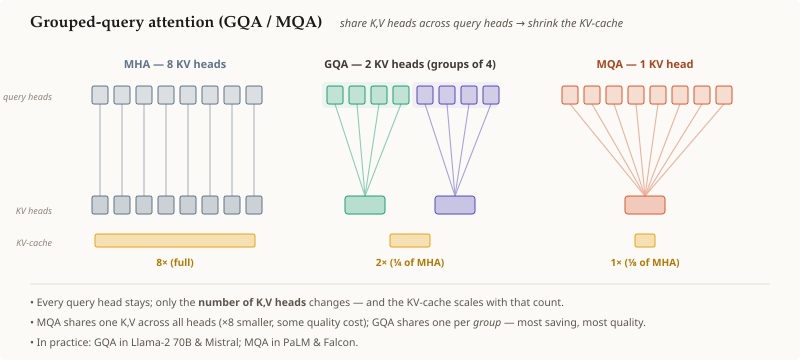

# 그룹 쿼리 어텐션(GQA / MQA)

## 요약

[[multi-head-attention]]에서는 보통 각 질의 헤드가 자신의 키와 값을 갖는다. [[kv-cache]] 저장량을 줄이기 위해 MQA는 모든 질의 헤드가 하나의 키/값 헤드를 공유하고, GQA는 여러 질의 헤드를 그룹으로 묶어 키/값 헤드를 공유한다. 저장량은 줄지만 품질과 실제 속도의 변화는 평가해야 한다.

## 상세 설명

[[transformer-attention]]의 생성 과정에서는 과거 토큰의 키와 값을 유지한다. 토큰 수 T, 계층 수 L, 저장된 키/값 헤드 수 H_kv, 헤드 너비 D에 대해 저장 원소 수는 2×T×L×H_kv×D다. 질의 헤드는 과거 상태로 같은 방식으로 저장하지 않으므로 질의 헤드 수와 키/값 헤드 수를 분리하는 것이 핵심이다.

MHA에서는 질의 헤드 h개에 키/값 헤드도 h개가 대응한다. MQA는 키/값 헤드를 하나로 줄여 모두 공유한다. GQA는 그 사이인 g개를 사용하며 각 그룹의 질의들이 하나의 키/값 헤드를 공유한다. 같은 너비를 유지하면 MHA 대비 저장량은 g/h가 된다. 공유는 표현을 제한할 수 있으므로 품질 유지가 자동으로 보장되지는 않는다. 기존 모델을 바꾸는 경우 체크포인트 적응 비용도 비교해야 한다.

## 질의 헤드와 저장된 키/값 헤드의 구분

질의 헤드 수를 H_q, 키/값 헤드 수를 H_kv, 헤드 너비를 D, 계층 수를 L, 보관 토큰 수를 T, 원소당 바이트를 B라 하자. 압축하지 않은 캐시는 메타데이터, 정렬 및 복제를 제외하면 2×L×T×H_kv×D×B바이트다.

L=32, T=1,024, H_kv=8, D=128, B=2이면 134,217,728바이트, 즉 128 MiB다. 다른 값을 유지하면서 H_q만 32에서 64로 바꾸면 질의 연산은 달라지지만 이 캐시 저장량은 그대로다.

보통의 MHA에서는 H_kv=H_q이고 D=d_model/H_q이므로 모델 너비를 유지하면 H_kv×D도 유지된다. GQA에서는 질의 헤드를 바꿀 때 D와 H_kv가 유지되는지 별도로 명시해야 한다. H_kv=8을 유지하면서 D를 128에서 64로 줄이면 저장량은 절반이지만, D를 고정한 채 H_q만 늘리면 그렇지 않다. 캐시 절감이 같은 품질이나 비례하는 전체 속도 향상을 증명하지는 않는다.

## 선수 지식

- [[transformer-attention]]
- [[kv-cache]]
- [[multi-head-attention]]

## 출처

- Ainslie 외, GQA, 2023: https://arxiv.org/abs/2305.13245
