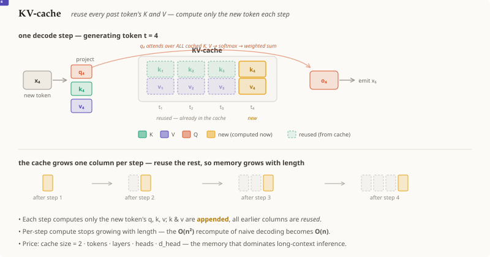

# KV 캐시

## 요약

트랜스포머가 텍스트를 한 번에 토큰 하나씩 **생성**할 때, 매 스텝의
[[transformer-attention]]은 **이전의 모든 토큰의 key와 value**를 필요로
한다. 이 값들은 한 번 계산되면 바뀌지 않으므로, 매 스텝마다 다시 계산하는
것은 순전한 낭비다. **KV 캐시(KV-cache)**는 각 토큰의 `K`와 `V`를 처음
생성될 때 저장해두고 유효한 상태로 보관되는 동안 **재사용**한다 — 그래서 새로운 스텝마다
**하나**의 새 토큰에 대한 query, key, value만 계산하고, 그 `K`/`V`를 캐시에
추가하고, 캐시 전체에 대해 어텐션을 수행한다. 이는 (시퀀스가 길어질수록
캐시도 커지는) **메모리**를 소모하는 대신 반복 계산량을 크게 줄이는
거래다.

## 상세 설명

[[transformer-attention]]을 다시 떠올려보자:
$\mathrm{Attention}(Q,K,V) = \mathrm{softmax}(\tfrac{QK^{\top}}{\sqrt{d_k}})\,V$.
**자기회귀(autoregressive) 디코딩**에서는 모델이 이미 토큰 $1..t-1$을
생성했고, 이제 토큰 $t$를 만들어낸다. 핵심 사실은 다음과 같다:

1. **새로운 query만 중요하다.** 스텝 $t$의 출력은 그저 *새로운* 행,
   $o_t = \mathrm{softmax}(\tfrac{q_t K_{1:t}^{\top}}{\sqrt{d_k}})\,V_{1:t}$
   일 뿐이다 — 단일 query $q_t$가 지금까지의 **모든** key/value에
   어텐션하는 것이다. 이전 출력 행들은 이미 방출되었고 결코 다시 계산되지
   않는다.
2. **과거는 고정되어 있다.** 어텐션이 **인과적(causal)**이기 때문에(토큰
   $t$는 $1..t$만 볼 수 있다), 이전 스텝에서 계산된 key $K_{1:t-1}$과 value
   $V_{1:t-1}$은 스텝 $t$에서도 **동일**하다. 다시 계산할 이유가 없다.
3. **그러니 캐시하라.** **K-캐시**와 **V-캐시**라는 두 개의 점점 커지는
   버퍼를 유지한다. 스텝 $t$에서: 새 토큰 하나를 $q_t, k_t, v_t$로
   투영하고; $k_t$를 K-캐시에, $v_t$를 V-캐시에 **추가**하고(새 열 하나);
   그런 다음 이제 $t$개가 된 캐시된 열들에 대해 위의 어텐션을 수행한다.

이로써 스텝당 비용이 *$t$개 토큰의* `K`/`V`를 *다시 계산하는* 것에서 **하나만**
계산하는 것으로 바뀐다 — 길이 $n$인 시퀀스를 생성하는 비용이 $O(n^2)$의
반복 투영 작업에서 $O(n)$으로 떨어진다. 대가는 메모리다: 캐시는
$2 \times n_\text{tokens} \times n_\text{layers} \times n_\text{KV heads} \times d_\text{head}$
개의 값을 보관하며, 일부 긴 컨텍스트 또는 큰 배치 워크로드에서는 이것이 **지배적인 메모리 비용**이
될 수 있다 — 이것이 이후 더 적은 KV 헤드(GQA/MQA), 페이지 단위 캐시
메모리, KV 양자화(KV-quantization)를 동기부여하는 압력이다.

## 저장량 증가와 밀집 어텐션 점수의 증가를 구분하기

유지한 길이가 모두 T인 B개 시퀀스, L개 레이어, 저장되는 KV 헤드 H_kv개, 헤드 너비 d, 스칼라당 b바이트를 가정하자. 일반적인 전체 이력 캐시의 페이로드는 2 B L T H_kv d b바이트다. 앞의 2는 키와 값을 세며, 아키텍처와 배치가 고정되면 T에 선형으로 증가한다. 할당 패딩, 임시 작업 공간, 스케일 메타데이터와 공유 프리픽스의 회계 처리는 제외한 식이다. 저장되는 KV 헤드 수가 쿼리 헤드 수와 같을 필요는 없다.

작은 예로 B=1, L=2, T=4, H_kv=2, d=3, b=2이면 페이로드는 2×1×2×4×2×3×2=192바이트다. 유지할 토큰 하나를 추가하면 48바이트가 늘어 240바이트가 된다. 별개로, 전체 밀집 프리필(prefill)의 쿼리-키 상호작용 수는 길이에 대해 제곱으로 증가하고, 새 디코딩 쿼리는 이력 길이에 따른 한 행을 읽는다. 이전 상태를 캐시한다고 이 읽기 비용이 상수가 되거나 모든 어텐션 계산이 없어지는 것은 아니다. 마스크, 위치, 모델 호환성과 캐시 사용·재계산 결과를 검증해야 재사용한 바이트를 올바른 상태로 취급할 수 있다.

## 선행 지식

- [[transformer-attention]]

## 출처

- <https://huggingface.co/docs/transformers/cache_explanation>
