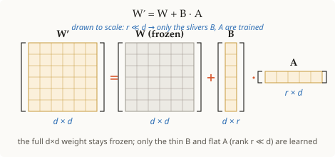

# LoRA (Low-Rank Adaptation)

## Summary

LoRA (Low-Rank Adaptation) adapts a large pretrained model to a new task by
*freezing* the original weight matrix `W` and learning only a small low-rank
update `ΔW = B·A`. At inference the model uses `W + B·A`. Because only `B` and
`A` are trained, the number of trainable parameters drops by orders of magnitude.

## Grounded explanation

The whole idea rests on [[low-rank-factorization]]: instead of updating all `d²`
entries of `W`, LoRA assumes the *change* needed to adapt the model is itself
low-rank, so it represents `ΔW` as `B·A` with a tiny `r`. Training touches only
`2dr` parameters while `W` stays fixed.

Where these weight matrices live inside the model is grounded in
[[transformer-attention]] — the original LoRA study applies updates to attention projection matrices, while later implementations can target other linear layers. [[fine-tuning]] supplies the adaptation objective.

## Prerequisites

- [[low-rank-factorization]]
- [[fine-tuning]]
- [[transformer-attention]]

## Visual

**1 · Symbols** — 🟦 scalar · 🟩 vector · 🟧 matrix

| Symbol | Type | Shape | Meaning |
|--------|------|-------|---------|
| $W$ | 🟧 matrix | $d\times d$ | frozen pretrained weight (never trained) |
| $\Delta W$ | 🟧 matrix | $d\times d$ | the learned update, forced to be low-rank |
| $B$ | 🟧 matrix | $d\times r$ | trainable factor, initialized to $0$ |
| $A$ | 🟧 matrix | $r\times d$ | trainable factor, initialized random |
| $x$ | 🟩 vector | $d$ | input activation |
| $h$ | 🟩 vector | $d$ | output activation |
| $r$ | 🟦 scalar | — | rank of the update; $r \ll d$ |
| $\alpha$ | 🟦 scalar | — | scaling constant (update scaled by $\alpha/r$) |
| $d$ | 🟦 scalar | — | model dimension |

**2 · Equation**

$$\Delta W = B\,A \qquad \text{(the update is low-rank)}$$

$$h = W x + \tfrac{\alpha}{r}\,B\,A\,x \qquad \text{(forward pass — only } B,\,A \text{ are trained)}$$

**3 · Shape**

Trainable parameters: $2dr$ (just $B$ and $A$) instead of $d^2$ — $W$ never
moves. At inference the update **can be merged** into the frozen weight as $W' = W + (\alpha/r) B A$, yielding the same linear operation without an extra adapter matrix multiplication. This requires materializing or serving a merged weight for that adapter. An **unmerged** adapter route computes the low-rank update at request time and may add latency, memory traffic, or runtime overhead; the size depends on implementation, batch shape, and adapter switching. A shared base model serving many adapters may deliberately keep them separate to avoid duplicating full merged weights. Benchmark both routes at matched precision and workload rather than assuming zero overhead for every deployment.

## Sources

- arxiv:2106.09685
