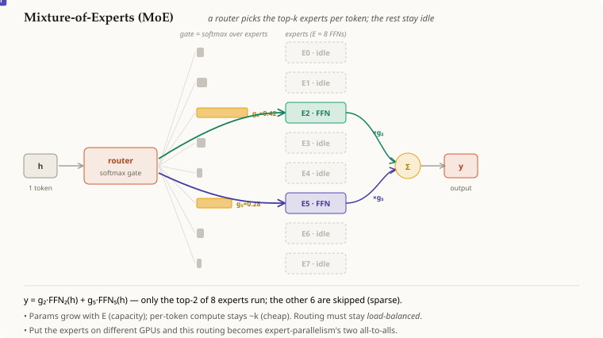

# Mixture-of-Experts (MoE)

## Summary

A **Mixture-of-Experts (MoE)** layer replaces the transformer's *single*
feed-forward block with **many** of them — each a small `[[neural-network]]` FFN
with its **own** weights, called an **expert** — plus a **router** that, for every
token, picks only the **top-k** experts to actually run. This **decouples** total
parameters from per-token compute: stack hundreds of experts (huge capacity) while
each token still flows through only $k$ of them. With fixed expert dimensions this keeps the expert-evaluation work bounded, not the entire layer runtime constant. Router work, weight storage, communication and uneven expert load still matter.

## Grounded explanation

A normal transformer layer sends **every** token through **one** FFN — a
`[[neural-network]]` block. MoE changes that block into a population of $E$ experts
$\{\text{FFN}_1, …, \text{FFN}_E\}$, each with independent weights, gated by a router:

1. **Route (the gate).** A learned linear layer scores the token's hidden vector $h$
   against the experts and normalizes with [[softmax]]:
   $g = \mathrm{softmax}(W_r\,h) \in \mathbb{R}^{E}$ — a probability over experts.
2. **Select top-k (sparsity).** Keep only the $k$ largest gates (typically $k=1$ or
   $2$); the other $E-k$ experts are **not run** for this token. With fixed expert dimensions, active expert work scales with $k$, while total expert parameters scale with $E$. The flat scoring projection still computes $E$ scores per token; increasing $E$ can increase routing cost and reduce tokens per expert. Capacity is not free memory or constant end-to-end latency.
3. **Compute + combine.** Run the token through its selected experts and take the
   gate-weighted sum of their outputs:
   $y = \sum_{i \in \text{top-}k} g_i \, \text{FFN}_i(h).$
   The gate values double as mixing weights, so the router is trained end-to-end. Implementations differ in whether selected weights are renormalized after masking; state the intended convention rather than assume all sparse gates use the same one.

They are called **experts** because, with this routing, each FFN tends to
**specialize** during training (different experts handle different kinds of tokens) —
the roles emerge, they are not assigned. The main difficulty is **load balance**: the
router can collapse onto a few favourite experts, so an auxiliary balancing loss
nudges traffic to spread evenly.

A dense FFN and one expert are the *same* kind of block — MoE just adds *many* and a
gate. And once you have many experts, you can place them on different GPUs: that is
expert-parallelism, where the routing above becomes two `all-to-all`s.

## Capacity is not active work or wall-clock time

Assume eight experts with one million parameters each and two experts selected per token. Total expert storage represents eight million parameters, while two million expert parameters participate in that token's selected evaluations. Doubling to sixteen same-sized experts doubles expert parameter storage to sixteen million, but still selects two million per token. This arithmetic excludes shared layers and router weights; parameter participation is not a literal count of arithmetic operations or bytes read.

The flat router now scores sixteen rather than eight experts. At fixed token volume, more experts can also mean smaller expert batches, more uneven work and different communication. Training stores optimizer state for the full parameter population even though one token activates only a subset. Therefore fixed active-expert count does not imply fixed training cost, device count, serving latency or model quality. Compare complete paths at a stated load and quality, and distinguish total parameters, active expert parameters, actual arithmetic and measured runtime.

## Prerequisites

- [[neural-network]]
- [[softmax]]

## Sources

- <https://arxiv.org/html/1701.06538v1> — sparse conditional expert computation and routing overhead.
- <https://arxiv.org/html/2006.16668v1> — sparse scaling, finite expert capacity and distributed execution.
