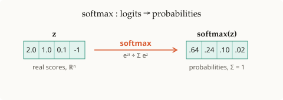

# Softmax

## Summary

**Softmax** turns a vector of real-valued scores (logits) into a probability
distribution — every entry positive and the whole thing summing to 1.

## Grounded explanation

Apply the always-positive [[exponential-function]] to each score, then normalize
by their sum ([[arithmetic]]):

$$\mathrm{softmax}(z)_i = \frac{e^{z_i}}{\sum_{j=1}^{n} e^{z_j}}$$

Exponentiation guarantees positivity and amplifies gaps between scores; dividing
by the total forces the outputs to sum to 1, making the output a valid
[[probability-distribution]] (every entry non-negative, all entries summing to
exactly 1). The largest logit gets the largest share — a smooth, differentiable
stand-in for "pick the maximum."

### Candidate-set dependence and binary decisions

Let $Z=\sum_{j=1}^{n}e^{z_j}$ denote the old denominator, and add one new candidate with finite logit $u$ while keeping every old logit fixed. An old candidate's new probability is

$$p'_i=\frac{e^{z_i}}{Z+e^u}=p_i\frac{Z}{Z+e^u}.$$

Every old probability decreases by the same factor. Their pairwise order is unchanged, although the new candidate can become the overall maximum. For original logits $[\log 9,0]$, the probabilities are $[0.9,0.1]$. Adding another candidate with logit $0$ gives $[9/11,1/11,1/11]$: the original winner remains first but no longer clears a $0.9$ threshold. This denominator effect alone cannot make old scores increase; an observed increase requires another change such as different logits or a different gate.

With exactly two logits, comparing probabilities requires no normalization: $p_1>p_2$ exactly when $z_1>z_2$, or when the difference $z_1-z_2$ is positive. It is the *difference*, not the sign of either arbitrary logit, that determines the binary winner. Equal logits produce a tie whose decision rule must be specified separately.

The output is a normalized distribution over the offered candidates. That mathematical property does not measure how often the winner is correct on held-out examples. All logits can be shifted by the same constant without changing any probability, so their absolute size is not an intrinsic certainty measure either. Softmax can be part of a useful probabilistic classifier; empirical correctness and the reliability of any threshold still require separate evaluation, especially after changing the candidate set.

## Prerequisites

- [[exponential-function]]
- [[arithmetic]]
- [[probability-distribution]]

## Visual

**1 · Symbols** — 🟦 scalar · 🟩 vector · 🟧 matrix

| Symbol | Type | Shape | Meaning |
|--------|------|-------|---------|
| $z$ | 🟩 vector | $n$ | input logits (real scores) |
| $\mathrm{softmax}(z)$ | 🟩 vector | $n$ | output probabilities |
| $n$ | 🟦 scalar | — | number of classes / tokens |

**2 · Equation**

$$\mathrm{softmax}(z)_i = \frac{e^{z_i}}{\sum_{j=1}^{n} e^{z_j}}, \qquad \sum_{i=1}^{n}\mathrm{softmax}(z)_i = 1$$

**3 · Shape**

## Sources

- [PyTorch softmax reference](https://docs.pytorch.org/docs/2.14/generated/torch.nn.functional.softmax.html): normalization formula and axis semantics. Candidate-set and binary identities above are direct derivations.
