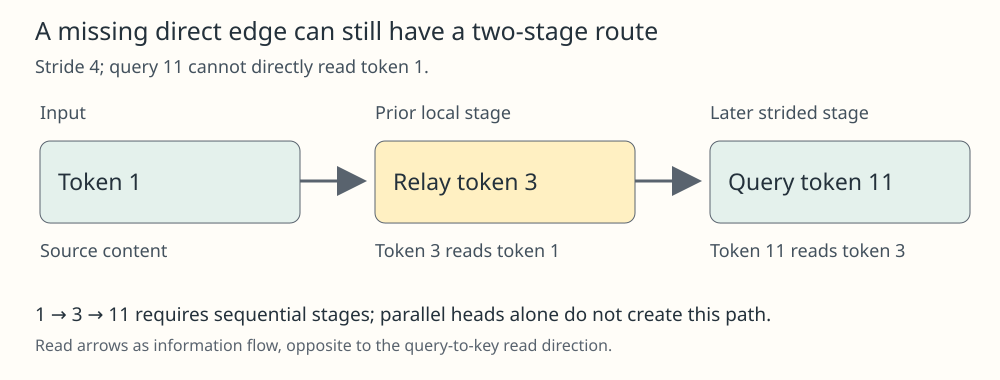

# Strided Sparse Attention

## Meaning

A local window cheaply reads neighboring tokens but cannot directly read a distant fact. A strided pattern adds periodic long-range connections. In the Sparse Transformer construction, local and strided attention stages can route information through intermediate positions; this changes the connectivity, not merely the implementation of dense attention.

## Mechanism

Number tokens from zero. For query position i and positive stride L, use a causal local set from max(0, i−L) through i, and a strided set of past positions j satisfying (i−j) mod L=0. The modulo condition means “the difference is an integer multiple of L”; it is relative to the query, not the same absolute list for every query. These are concrete [[sparse-attention-patterns]]. Sequential stages or layers are needed for one stage's gathered information to feed another; parallel heads do not exchange their newly computed outputs during that same attention operation.

The two kinds of edge supply complementary access. A token can first write information into a nearby relay whose index is on a later query's stride, then that later query can read the relay. Connectivity does not mean the sparse model computes the same function as dense attention, or that training will reliably use every available route. Boundary masking and layer ordering remain part of the construction.

## One example

Take query i=11 and L=4. Its local set is 7,8,9,10,11; its strided set is 3,7,11. Position 1 is absent from both. At a prior local stage, position 3 can read position 1 because its local set runs from 0 through 3. A subsequent strided stage at 11 can therefore receive information about position 1 through relay 3. Without the prior stage, query 11 does not gain position 1 merely because a parallel local head is also present. This is a path across stages, not a new direct edge.

## Check your understanding

Is fixed stride a universal text-retrieval solution? No. A periodic layout can match image or audio structure but poorly align with irregular language relations. The primary paper motivates a different fixed pattern for text. Test long-range fact placement, depth, task quality, actual kernel execution and cost; an available path is only a structural condition for useful information transfer.

## Prerequisites

- [[sparse-attention-patterns]]

## Sources

- <https://arxiv.org/html/1904.10509v1>
