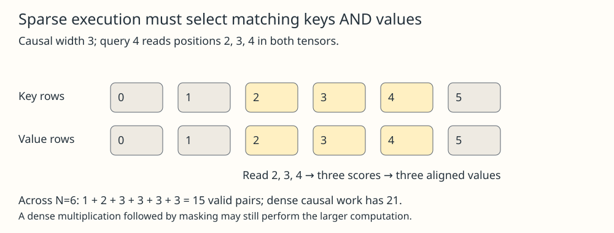

# Tensorized Sparse Attention

## Meaning

A sparse attention rule says which query-key pairs may interact. A [[tensor]]-based implementation arranges those interactions into operations an accelerator can execute efficiently. Writing a dense score matrix and then masking most entries preserves the rule, but may not save the dense multiplication or its storage.

## Mechanism

For a local example, let N be sequence length, d feature width and w the maximum keys selected per query. Each query chooses w or fewer key indices; gather the matching key and value rows or visit their blocks directly. Compute selected dot products, normalize over permitted keys and accumulate their weighted values. [[sparse-attention-patterns]] provides the connectivity rule. Values must use the same selected indices as keys; a correct-looking score shape does not establish that association.

An explicitly materialized window tensor has up to N×w×d elements per batch/head. Creating it is not generally O(N) copying: storing all those elements costs proportional to their count. A strided view may avoid copies but can overlap storage, require bounds/masks and still lead later operations to materialize data. A fused implementation can load key/value tiles as needed without storing every expanded window. The PyTorch FlexAttention primary article distinguishes score modification from a block mask that lets a kernel skip fully masked blocks.

## One example

Take N=6, d=2 and causal width w=3, including the query itself. Query 4 reads key/value rows 2,3,4. Its score row has three entries, not six; normalized weights multiply those same three value rows. Across the sequence, valid pair counts are 1+2+3+3+3+3=15 rather than 21 causal dense pairs. A rectangular implementation may reserve 18 slots and mask boundary padding. At N=6 that overhead can erase a benefit; asymptotic edge reduction is not a measured speedup.

## Check your understanding

Does expressing the computation as one tensor operation guarantee efficiency? No. Under [[gpu-kernel-benchmarking]], compare mask-equivalent outputs and gradients, causal boundaries, all-masked rows, temporary memory, mask construction, forward/backward time and hardware. Report block occupancy and irregular access costs. Padding and gather overhead can dominate small or poorly structured patterns; keep a dense reference for correctness, not as evidence of sparse execution.

## Prerequisites

- [[tensor]]
- [[sparse-attention-patterns]]
- [[gpu-kernel-benchmarking]]

## Sources

- <https://pytorch.org/blog/flexattention/>
- <https://arxiv.org/html/1904.10509v1>
