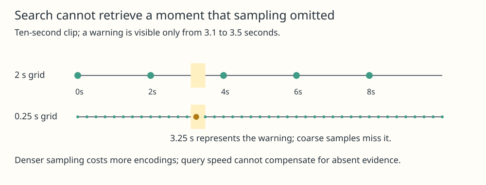

# Timestamped Video Retrieval

## Meaning

Timestamped video retrieval connects a text query to inspectable moments in a video. It does not merely return a matching file or an image with a guessed position. Every indexed representation needs video identity, source revision and presentation timestamp so its match can lead back to the actual evidence.

## Mechanism

Decode permitted video content, choose a sampling policy and store each selected frame with its timestamp. Use [[multimodal-embedding-alignment]] to compare compatible text-query and frame representations. Rank candidate frames, group nearby hits when useful and open the corresponding source time. A frame encoder captures visual evidence; it does not automatically represent speech, sound, motion direction or an event occurring between samples.

Sampling trades coverage for indexing work. A fixed interval is simple, while scene changes or denser sampling can catch events it misses. For variable-frame-rate media, derive time from the decoded frame's presentation timestamp rather than assuming frame number divided by one global rate. Seeking can land at a nearby decoding boundary; the UI should preserve the requested time and its actual landing behavior.

CLIP's official implementation supplies paired image and text encoding and normalized-feature scoring, not a complete video-search system. Applying an image-text model to sampled frames is one design with clear temporal limitations. Do not infer that a text-only embedding checkpoint can process images or that a high similarity score proves a clip contains an entire described event.

## One example

In an invented ten-second clip, frames are sampled at times 0, 2, 4, 6 and 8 seconds. A red warning appears only from 3.1 to 3.5 seconds, so none of those samples can show it. Sampling at 0.25-second intervals includes frames at 3.25 and 3.5, subject to the actual frame times and endpoint convention. That costs roughly eight times as many frame encodings as a two-second interval. No faster vector search can recover an event never represented.

## Check your understanding

Is nearest-frame ranking the same as correct temporal localization? No. Under [[measurement]], evaluate moment recall, landing-time error, brief-event misses, duplicate hits and query-to-evidence support. Compare denser sampling, transcripts and temporal encoders on the same corpus. Report decoding/indexing and query costs separately, including corpus revisions and memory.

## Prerequisites

- [[multimodal-embedding-alignment]]
- [[measurement]]

## Sources

- <https://github.com/openai/CLIP>
